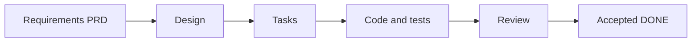

# agent-matrix

[中文](README.md) · [Adoption guide](docs/ADOPTION.md) · [Worked example](docs/EXAMPLE.md) · [MIT](LICENSE)

**A lightweight engineering loop for clear requirements, consistent contracts, and verifiable multi-agent delivery.**

agent-matrix is a stack-neutral method package. A small set of Markdown sources, explicit contracts, and review gates help prevent guessed requirements, incompatible interfaces, overwritten work, and premature claims of completion.

For developers, technical leads, and open-source maintainers. Use it alone or with several agents, without a required model vendor, orchestration platform, or application directory layout.

## The loop



- **Requirements and contracts first:** separate CONFIRMED, INFERRED, and TODO_CONFIRM; bind tasks to requirements, designs, files, and verification.
- **Controlled collaboration:** load relevant context, assign one writer, and record handoffs. Reuse existing project sources instead of creating parallel trackers.
- **Evidence before completion:** real tests, appended review history, and a hard unresolved P0/P1 gate before DONE.

## Start in one minute

1. Open the [adoption guide](docs/ADOPTION.md#接入步骤) and copy its complete initialization prompt into an agent working in your project.
2. Have the agent inspect Git, existing rules, documentation, and real code before incrementally adding or mapping the sources. Preserve existing work and application structure.
3. Review the initialization report, resolve decisions, then request a specific task or a scoped goal. Initialization itself does not implement features or commit changes.

**Do not copy this repository's PRD and task history as your project's own requirements or progress.** They maintain agent-matrix itself. The adoption guide provides the blank contracts to adapt. Detailed guides and templates are currently in Chinese; this English entry describes the same workflow, commands, and limits.

## Assets

| Asset | Purpose |
| --- | --- |
| [Adoption guide and templates](docs/ADOPTION.md) | Complete initialization prompt, AGENTS/PRD/DESIGN/TASKS contracts, incremental adoption and evolution |
| [Worked example](docs/EXAMPLE.md) | EX- requirement, design, task, executable red/green checks, and clearly illustrative review |
| [Agent rules](AGENTS.md) | The effective rules for maintaining this repository, including context loading and ownership |
| [PRD](docs/PRD.md) / [DESIGN](docs/DESIGN.md) / [TASKS](docs/TASKS.md) | This repository's single sources of requirements, designs, and task progress |
| [Review rules](docs/reviews/README.md) | One main report per task, append-only history, severity and completion gates |
| [Contributing](CONTRIBUTING.md) | Change process, verification, and explicit staging scope |

A target project normally needs AGENTS, three document sources, and reviews. Map existing equivalents instead of replacing them. Java/Spring, Python, Node.js/full-stack, CLI/library, and documentation projects use their actual structure; no Controller/Service layering or package manager is prescribed.

## Verify this repository

From the repository root, use Python 3.9+. Tests and staged checks also require the Git CLI. No third-party packages or services are required.

```sh
python3 -m unittest discover -s tests -v
python3 scripts/check_docs.py
python3 scripts/check_docs.py --example-red
python3 scripts/check_docs.py --example
```

After explicitly staging your changes, run `python3 scripts/check_docs.py --staged` to check the actual index and its agreement with the workspace. These commands never stage, commit, or push for you.

The red command succeeds only when tests detect the intentional defect. The green command requires all 14 boundary/type cases to pass. The checker covers local links/anchors, traceability, statistics/dependencies, completion evidence, licensing, and release hygiene. Adapt its schema and release allowlist before reusing it in another project.

## Scope and limits

This release provides production-oriented engineering conventions and local verification. It does not ship an automatic scheduler, distributed lock service, or cloud deployment platform, and does not claim production validation across all stacks. Manual coordination is not atomic mutual exclusion; static checks do not replace requirements, security, or production review.

Codex, Claude, Hermes, and Gemini roles are replaceable capability suggestions. Distinguish author self-review from real independent review. Historical initialization records are audit material, not installation steps or another progress source.

Contributions follow the [contribution guide](CONTRIBUTING.md). Licensed under [MIT](LICENSE), attributed to agent-matrix contributors.
